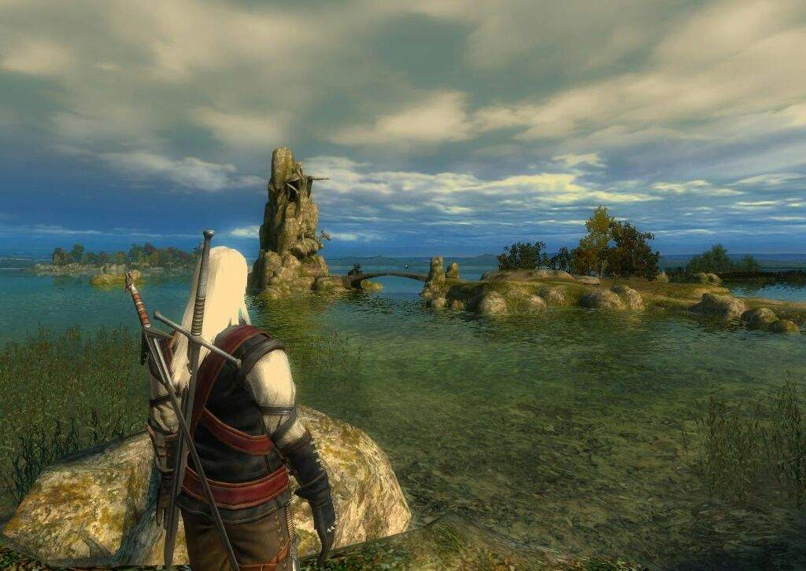
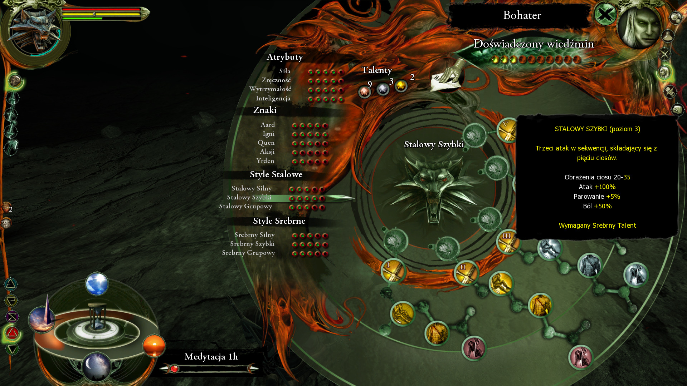
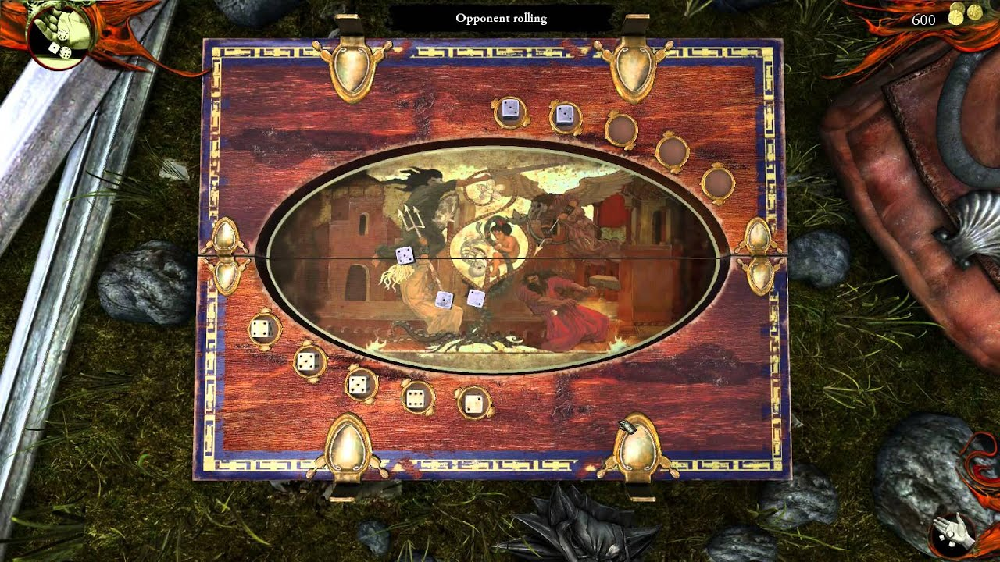
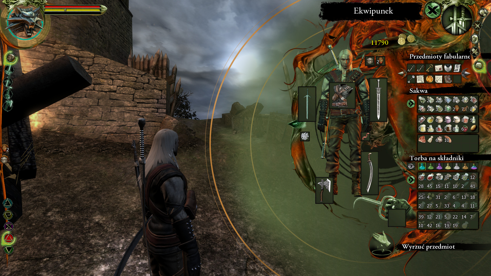
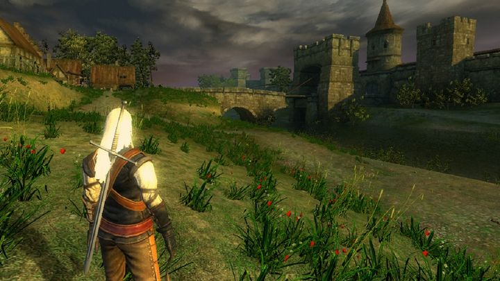
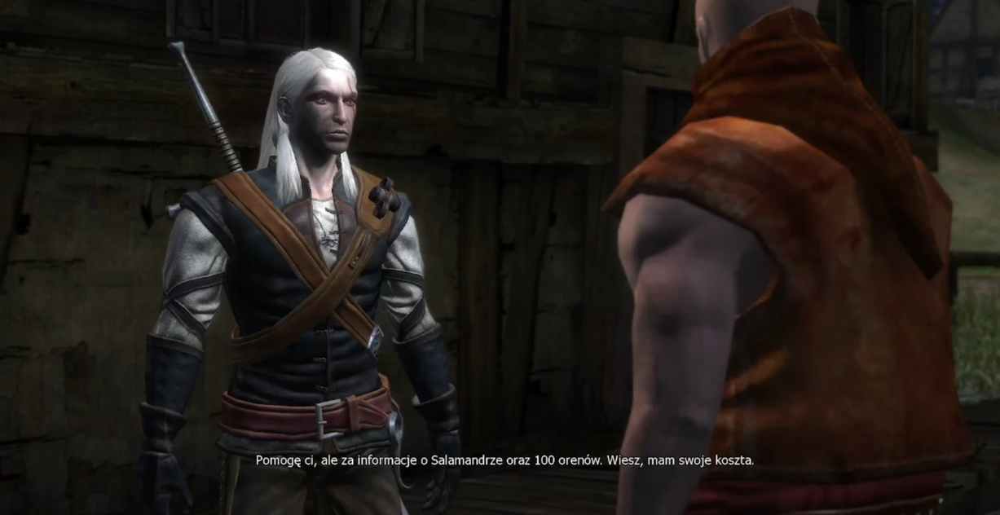
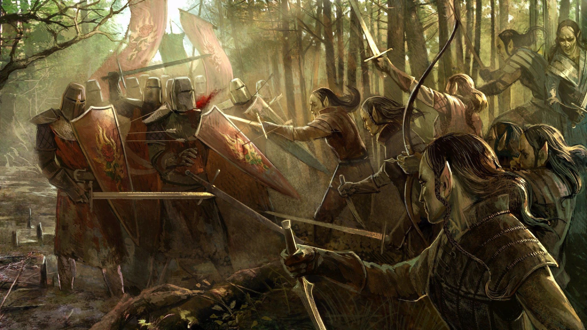

Witcher 1 is one of my favorite games of all time.
It atmosphere does a better job of portraying a central/eastern Europe environment than anything else I've ever seen,
and its hauntingly beautiful atmosphere is juxtaposed with exploring various ugly themes related to the human condition.
All the while employing several fantastic RPG design choices that harken back to the Gothic games.
It is also more faithful to the Witcher books than the games that came after it, or the dreadful Netflix show
(I'm not gonna argue that the Polish 2000s show is a masterpiece, but it does do several things better than any other adaptations).

Thankfully the above is not just a rose-tinted glasses view of a game I played as a teenager;
The Witcher still holds up, although there are a few caveats, of course.

There's one caveat to keep in mind while reading this:
Compared to the Polish original, the English version has things lost in translation.
The voice acting seems very wooden and the dialogues might not be nearly as witty.

## What the game is about

In short, Witchers are biologically enhanced monster hunters.
In the games we play as Geralt, one of the protagonist of the books and the main one from the short stories.
Witcher 1 picks up after giving Geralt amnesia and plopping him down near the witcher home base, a ruined castle of Kaer Morhen.
After a very short time the witchers are attacked by a group of magic-backed assailants who steal their secret mutation research.

What ensues is a broad investigation that takes Geralt across many facets of the medieval-like society,
with intrigues ranging from small villages and city slums to the highest echelons of the Temerian court.
The plot of this game is generally quite good - if you're used to American game writing,
this game will be a breath of fresh air.

## It's witchering time (i.e: gameplay and role-play)

The game has an unusual way of doing RPG combat.
To chain combos, you need to time your clicks to the visual and sound cues at the end of the current attack sequence.
It is a decent system, although it gets monotonous after a point.
Thankfully the game's potion and magic systems allow you to completely blast enemies within seconds,
given a little preparation and selecting specific upgrades.

Speaking of which, the skill tree is very flavorful here, divided into many categories and having 3 types
of points (bronze, silver and golden talents) to spend.
This is also thanks to the very unique UI styling and layout.

Where the game really shines are the role-playing aspects.
We have 3 sword fighting styles, suited for different enemies and situations.
Geralt can't do regular magic and "cast fireballs" - instead, he uses simplistic "signs",
which is a really unique way of framing a magic system.

To prepare for battles, Geralt has to gather herbs to brew potions and sword oils (which buff damage).
The potions can have secondary effects if we carefully choose ingredients,
and cannot be drank haphazardly; they are toxic, so there's only a set amount we can consume in a short time.
These elements do a lot to reinforce the role-play, some of which I sorely miss in the sequels,
as they simplified the brewing gameplay and eventually made it semi-automatic in 3.

The game also has many other small mechanics and minigames which tie into the plot.
We have fist fights, bribing (where in a great piece of realism we need to guess an amount of money and not undershoot),
drinking, gifts, and a fantastically diegetic dice game, all of which often serve as tools to progress quests.
A particularly cute quirk is that characters have gift and drink preferences - certain women will only accept
a specific part or color of clothing, a specific type of gems,
and noble women will not be interested in cheap jewelry.
People Geralt drinks with have preference to certain types of alcohol,
refusing to cooperate if we give them something they didn't want.

Lastly, we have certain smaller things, like having to rest at bonfires or taverns to make potions or pass the time
(when waiting for a specific time of day), or vendors not buying random items from us.
Side quests are framed as literal gigs (often with flavorful twists though);
they are often advertised on notice boards and require talking with people to figure out what monster they're dealing with.
Generally the game heavily emphasizes preparation, which does wonders for immersion and the world's believability.

I love how all these small mechanics make you engage with the game's world in a realistic manner.
None of them are that deep, but together they form a much more immersive experience
than many other RPGs - even including the Witcher sequels, where many things were streamlined.
For example, Witcher 2 and 3 transition to a "garbage economy" where we collect dozens and dozens of
random crafting items; the inventory is infinite and opts for having a stupidly high weight
cap instead (which ends up being not enough anyway).

Oh, I almost forgot about the inventory!
We have a very limited space for weapons and a single slot for amour.
Getting new armour is a big deal in this game, as they are rare and often make for significant stat improvements
(this is one of these Gothic inspirations I mentioned).
Asides of that, we have 3 inventories for smaller items and multiple other slots:
- plot items (infinite storage),
- the sack: general storage for things like food, potions and trinkets
- alchemical ingredient bag
- 2 steel weapon slots, one silver sword slot
- shoe slot for daggers, which is a reference to one of the short stories.
In the screenshot Geralt has a small axe there, I'm not sure why it can be put in this slot.
- a hook for monster trophies (which serve as proof of killing monsters)
- ring slots on each hand (these also tie to story, as wearing certain signets can earn us favors)
- utility belt slots for potions and bombs

The layout, limitations and functions of the inventory all contribute to the role-play.
Geralt is not a cargo truck, he cannot lug 20 swords and armours around (which is also a thing in the sequels)
and only has small bags for other things.

Lastly, the huge 3D wolf medalion in the upper left corner also serves
a specific function - it vibrates when monsters or magic are around, warning us beforehand.
And guess what, this also strengthens the role-play.

## Atmosphere

The atmosphere of Witcher 1 is distinctly Polish;
grim and sometimes beautiful, largely thanks to the game's leaden skies and moody lighting.
The music is amazing. There's no other game which sounds like this, not even the subsequent Witcher games.
Like the game's locations, it's interchangeably ominous and beautiful.

Another big factor of the atmosphere is the level art.
It's unusually photorealistic, despite its very medium-range polygon counts typical for the 2000s.
The architecture is accurate to real-life medieval structures, nothing like typical fantasy settings.

The only liberty taken was with spacing roads and interiors;
to serve gameplay, almost every environment is very spacious and with tall ceilings,
as the game allows you to play with a pseudo-isometric camera.

Character design contributes a lot too.
Many of the NPCs we meet are caricaturally ugly which often matches their personalities
(although this is obviously due to bad modelling too - male elf models are unintentionally ugly).
We meet many unpleasant, vulgar and deplorable people - one of the more successful ways the game's writing follows the original books.
In fact, writing is a massive factor here; very few games replicate the absurdities of life like this one.
Paperwork, corrupt officers, shady interests, mob justice... the list goes on.
The story also features many situations which are amusing or put you in a contemplative mood,
and is filled with amusing and clever dialogues, as well as many highly quotable phrases.

## Painful choices

The Witcher has a particular approach to making choices.
The developers wanted to prevent classic save scumming where players reload immediately after a choice to get the better outcome.
To achieve that, consequences of choices are often significantly delayed.
While this is great game design, at times the consequences are barely related to the choice we made,
and more often than not they are just punishments.

Several times along its story the game demands you to take a side in the conflict
between two extremist factions: the Order and Scoia'tael - elf guerillas.
Our contact in the Order is the rather pleasant character of Sigfried, but his organization is a bunch of xenophobic fanatics.
On the other hand, we have the oppressed elves who are hard not to sympathize with;
the only caveat being that this specific group are terrorists and their leader is a massive douchebag.

In a few situations there's also the neutral option, which usually entails passively letting very bad things happen
and has the worst consequences to the world.
As a result, the neutral path ends up being the "everyone hates you" option in Chapter 5.

These choices are frustrating.
There is no compelling reason to join either of the sides, you're just forced to - often
because you ended up in the wrong place at the wrong time, or simply because someone wants something from you.
You don't really feel like you're choosing lesser evil; it feels more like choosing the lesser asshole, because both sides are equally shitty,
even if they might have a degree of noble reasons.

Which are exactly the points that the "The Lesser Evil" story from Sapkowski's books makes.
Executed pretty much down to a T.

I used to find this design choice annoying, but while writing this I realized that it might be secretly genius.
The game doesn't just tell you these things like a book does; it makes you *live* them,
something only a game can do.

The next closest thing is a similar choice in Witcher 2, where we choose between Temerian special forces and Scoia'tael.
This is made much more palatable by giving you good reasons towards joining either of the factions.
It remains a really hard choice, but it undoubtedly doesn't sell the same ideas.

## Chapters of the game

Since I praise the story of the game, it would be good to outline what happens in it.
I also wrote down some of my thoughts on each chapter. Minor spoilers inbound:
- Prologue: a nice intro in the semi-abandoned Kaer Morhen, but the combat is kinda boring due to many mechanics not being available yet
- Chapter 1: delving into the ugly underbelly of small village living. Good stuff.
One caveat is that the finale locks you out of the rest of the Chapter 1 contents
and happens as a culmination of a seemingly regular main quest, which makes it easy to miss out on content.
- Chapters 2 and 3 are the main course of the game.
Geralt conducts a long investigation into the Salamander crime syndicate in the city, both in the slums and uptown (unlocked in Chapter 3).
Tied into this is a mysterious magical tower in the swamp. Several big events punctuate this long stretch of story.
Many people hate the swamps - I think their oppressive atmosphere is fantastically done,
but it is good to minimize your time in them by collecting multiple things to do there first.
- Chapter 4: a weird holiday of sorts spent in an idyllic lakeside village.
This part of the game features quests inspired by classic Polish poems from the romance era,
which include themes of tragic love and ghosts.
Trekking across large fields shows the openness of the countryside nicely, but gets stale fast.
It is a nice break from dirty city environments though.
- Chapter 5: a war in the abandoned old quarter of the city and trudging across an even worse part of the swamp.
This chapter shouldn't have had sidequests that required backtracking,
because this bogs down the pace of an otherwise linear chapter.

## Issues and nitpicks

This concludes the part where I glaze the game for what I love about it.
Wouldn't be me if I didn't overanalyze every flaw.

### Handling of sexual content

The amount of horniness in this game can reach silly levels.
Which is ok, but if you stop to think about it for a moment,
the sexual encounters can be a bit tone-deaf and even go against the otherwise mature tone of the game.

Firstly, the way it is framed is... collectible cards.
There is no sex scene per se (with few exceptions), instead we get a brief generic blurred animation and a nude drawing.
They can be viewed in the characters screen and are even labelled as "cards" in the UI.
The drawings are tasteful and have a lot of creativity put into the posing and staging - I think they're pretty cool.


	
	


In itself it's not a big deal. Can be chucked up to budget limitations.
In fact I kind of prefer this than fully choreographed sex scenes, but that's neither here or there.

But combined with the sheer number (25) of the possible sex acts and some of the dialogues that lead to them,
this conjures a weird aura of "pick up artist" which feels a bit dirty.

Quests where sex is the whole point are the mildest issue, these are sometimes amusing.
The really questionable encounters are completely random (passer-by townswomen), transactional or borderline predatory.
The absolute worst case is a starving elf who lashes out at Geralt but will go to bed with him after he gifts her group some food.
Yikes.

Another bad case is the transactional romp with the witch Abigail, which happens with a literal pitchfork mob outside the cave we're in.
She proposes this to Geralt in exchange for protection,
and we can either accept this or deny it in a way that implies we're indifferent to her being burnt at stake.
There's no third option which would suit book Geralt the most: protecting her without expecting anything in return,
just because mob mentality pisses him off.
The fact that we can meet her later and she brushes this fling off suggests that the writers might have been blind to the optics of this situation.

There's also the case of Toruviel (another elf).
She and Geralt are in a war  zone safe house and he can suggest doing the deed.
She's outraged at this but then proceeds to order him to undress, which is admittedly a very amusing scene and I don't find it problematic in itself.
Having sex in face of death is a real human behavior, and it is even discussed (MUCH more realistically) in the books with the character Milva.
What I do mind though is that this doesn't gel with book Toruviel; this will be discussed later.

Bottom line is, while book Geralt does have a bunch of flings,
some of them even acknowledged to be haphazard or questionable, he was not definitely not *this* promiscuous.

### Faithful and not at the same time

As I mentioned in the introduction, I believe this game is up there as one of the most accurate adaptations of the books.
Both with the way it executes its themes (like the lesser evil) and with many subtler nods to the books.

However, the game also recycles large parts of the short stories by retelling them,
the frequency of which becomes quite absurd.
It feels a bit silly for all of this to happen almost back to back within days, all in the proximity of Vizima.

Another issue is the mischaracterization of multiple characters.

Coming back to Toruviel, she has absolutely no business being interested in Geralt sexually.
Book Toruviel passionately hates humans to the point of disgust and almost kills Geralt in one of the short stories.
She shows up several times later in the books and lets go of her pride and hate in a quite heartbreaking scene.
It doesn't mean she does a 180 on her beliefs, but this is exactly how she is portrayed in the game; waxing on reconciling with the humans.
The game does not do nearly enough to bridge these two disparate versions of the character.

Toruviel is a minor character though. Things get weirder.
- Triss is written more like Yennefer than book Triss. Some people even dub this character "Trissefer".
- Similarly, the game seemingly confuses Zoltan and Yarpen.
Zoltan spends one chapter with Geralt in the books, while Yarpen is present for a large part of the book
and has a real comradery with him. However, in the game Zoltan is supposedly Geralt's biggest buddy.
- Jaskier (a.k.a. Dandelion, Geralt's best friend), Triss, and other witchers do not even mention Yennefer and Ciri,
Geralt's true family and main characters in the books. It is really bizarre.
This contrivance makes Triss a terrible person,
as she effectively steals her best friend's man by taking advantage of his amnesia
(Triss romance is canonical in Witcher 2).
- The love plots with Shani and Triss are rushed and don't suit Geralt's character,
with love statements and plans of marriage sticking out like a sore thumb.
Geralt is infamously reluctant to show affection in this way.

It is worth pointing out though that there's also cases of the opposite!
For example, Shani is wonderfully expanded upon from the books. Foltest is very accurate.

### Complaint lightning round

I have a few other issues with this game but I don't want this post to be much longer than it already is.
- The game could use more challenge.
Hard mode feels barely different to normal and is in fact quite easy, asides from two boss fights which are overly difficult even on normal.
- Alvin is a classic "annoying video game child" character.
The plot is trying to force him, Geralt and his choice of woman (Shani/Triss) to be a family, which is quite annoying.
The way he just reappears in the same places as Geralt throughout the story is very contrived.
- There's a few cringy dialogues, particularly when the writers directly quote the books out of the blue.
It only lacks the characters turning back and looking into the camera.
- Some of the romance dialogues are great, but some of them sound like a bad Wattpad story.

## Add-ons

The game has several short add-ons, some made by CDPR (the developer) and some by fans.
I played 3 of them. The first two ones are official and have full dubbing (at least in the Polish editions):
- "The Price Of Neutrality": you can tell how much CDPR liked "The Lesser Evil",
as not only they made that into a key design feature (as I discussed earlier), but this bonus scenario is an
almost 1:1 transplant of that story onto different characters and setting.
The gameplay and plot are kinda barren if you already know the original story,
but it's worth checking out just to see some locations and characters cut from the main game.
- "Side Effects": a fun little adventure where you get to flex your money-earning skills. It could be harder though.
- "The Wedding": a genuinely funny joke adventure. Unfortunately it works in a very weird way and bugs stopped me from finishing it, despite reloading earlier saves.

## Closing thoughts

The fact that CDPR got this many things right on the first try is nothing short of amazing.
The Witcher 1 stands out even amongst the Witcher series -- as an achievement of role-playing built into game systems,
and the only game to accurately portray the melancholy of central European autumn.
On top of that it features some of the most unique dialogue writing I've ever seen.
I highly recommend it if you're into fantasy RPGs.

Unfortunately as I hinted in this post, the Witcher sequels would move into a slightly different direction.
I happen to have replayed Witcher 2 just after this game, so if things go right
(it took me 9 months to come back to this post to finish it)
another Witcher post will be up soon.