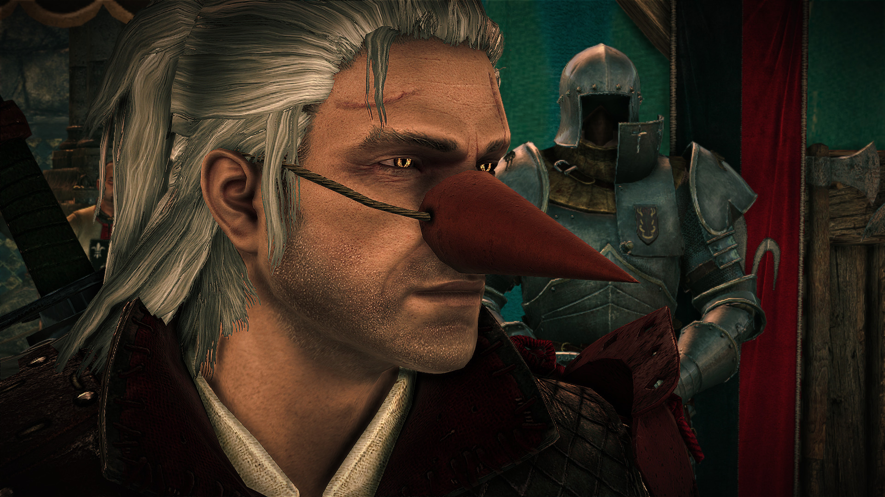
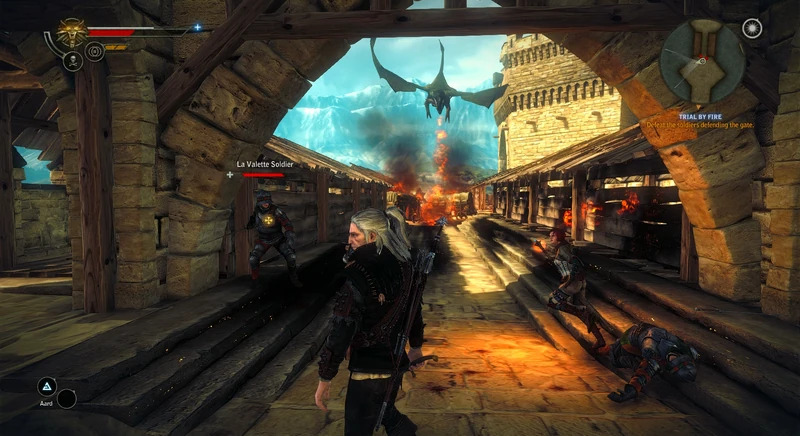
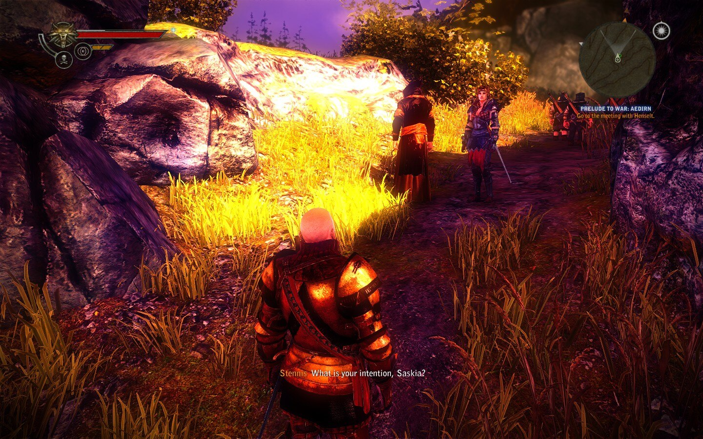
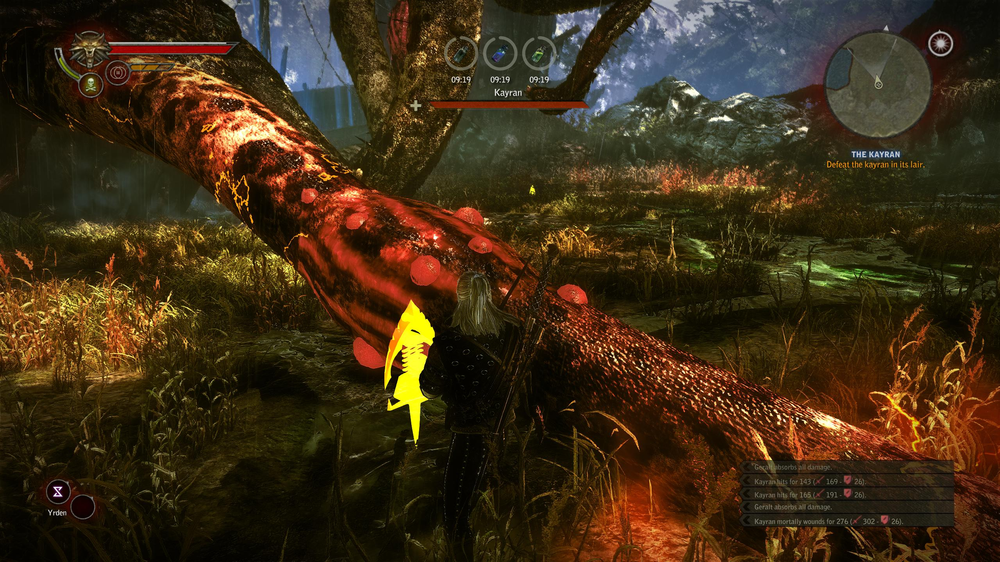
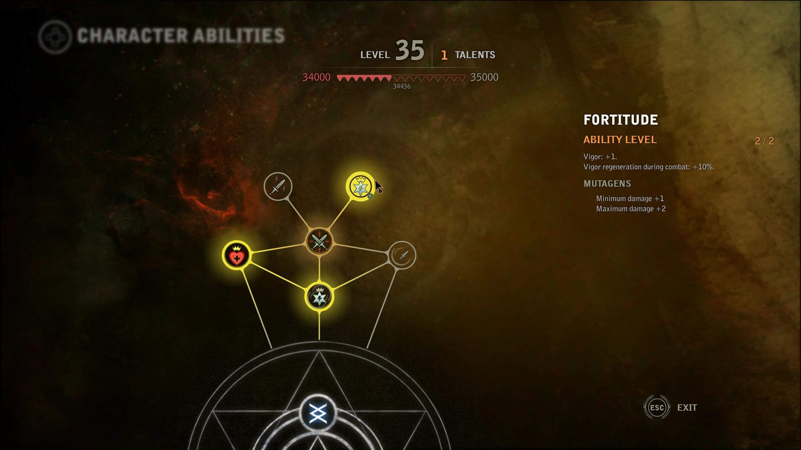
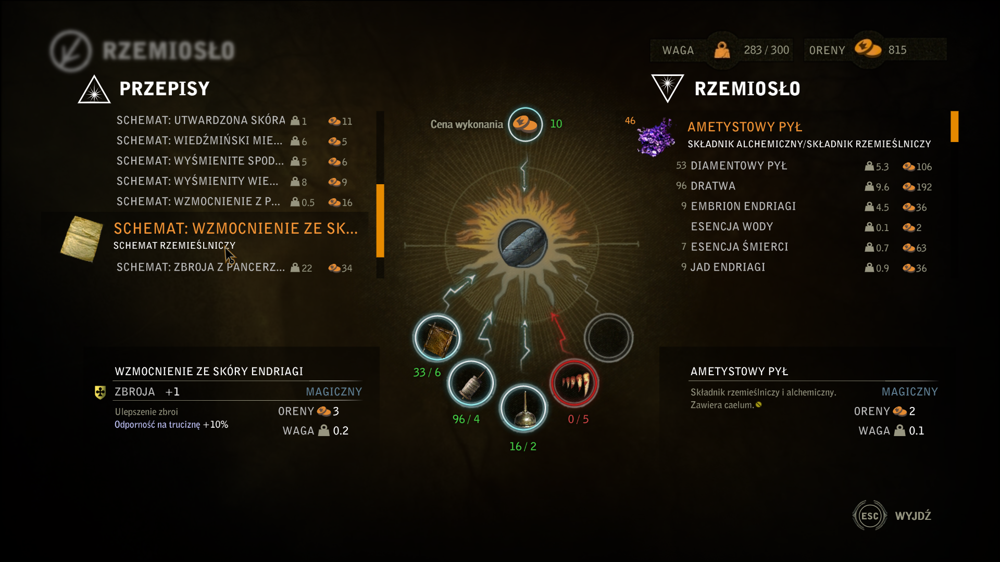
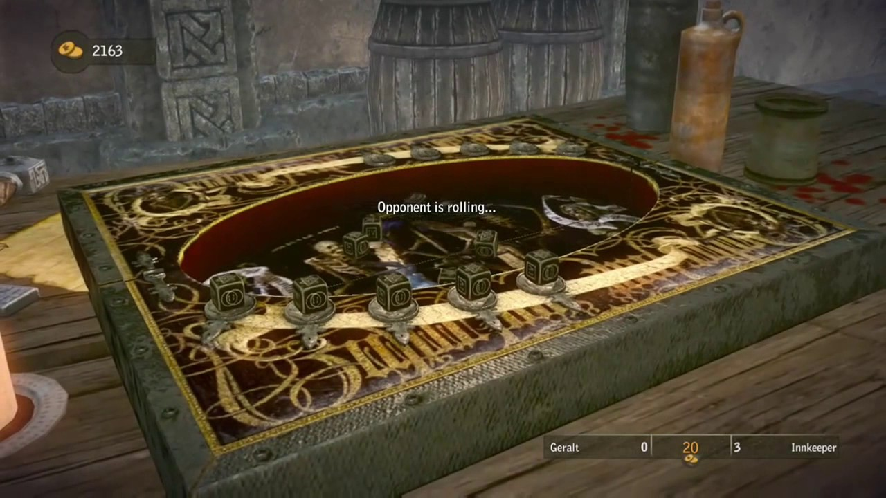
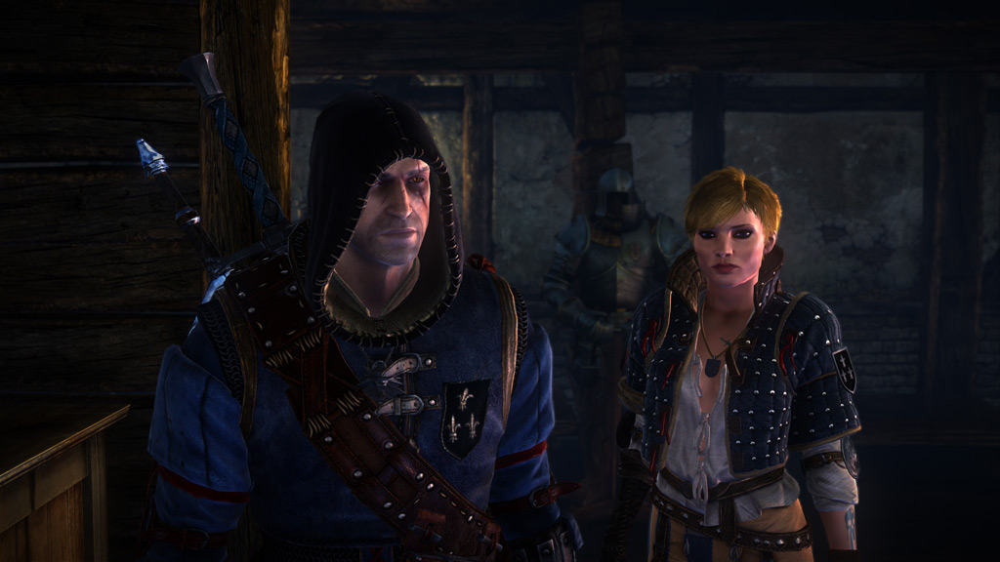
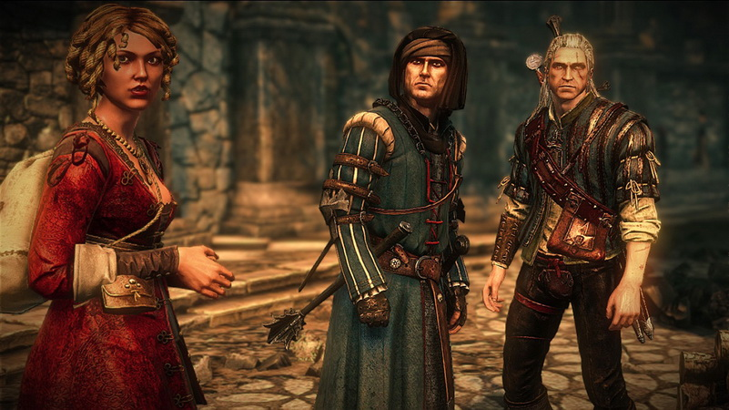

The pre-release period of "Witcher 2: The Assassins of Kings" was quite fun for me. It was one of the first times in my life when I was actively anticipating a new game release. Being big fans of [Witcher 1][w1-link], my friend group was very excited for the sequel. I even got a special edition with a bunch of nicknacks and a printed guide! Triss Merigold was in Playboy! (probably the only time a 3D character had a photo session for a magazine).

[w1-link]: /posts/witcher1

Sadly, Witcher 2 didn't really captivate my friend group like Witcher 1 did, but I think it has very memorable parts and unique merits. Unfortunately they have a hard time shining through, as issues arise from almost every facet of the game -- and this is not my usual overthinking, but very glaring flaws.

> [!NOTE]
> I am writing this several months after finishing the game, so I might not go super in depth about certain points because some of my notes were a bit vague. Perhaps for the better, as there is **a lot** to discuss about this game.

## Presentation

Witcher 2's atmosphere is almost an antithesis to Witcher 1 -- it adapts a "generic pop fantasy" style. Skyscraper castle, gargantuan trees and bridges, a boss the size of multiple buildings, everything is very colorful, and the music has a much more generic orchestral vibe than the 1st game -- although it mostly fades into the background (I do love the main theme though!). Thankfully at least the story is very "witchery" -- at least in terms of being similar to the books, but we'll get to that.

While a departure from the previous game, all of the above would be fine.
But there is one problem that borderline ruins the visuals; the color balance.
This game has a post-processing effect which makes the contrast and saturation incredibly high. It looks deep-fried half of the time and you cannot turn this effect down, not even through modding.

The game is already very orange because of that visual effect, but to make matters worse, the "witcher sense" mechanic (which you're incentivized to spam) adds even more orange to the already blown out visuals. When you scan the environment, this mechanic adds huge glowing particle effects to interactable objects.

Many parts of the Witcher 2's art are still **gorgeous** though. The locations are quite good and manage to sell their darkness despite the game being very colorful. This game also has some of the best fantasy fashion and armour design I've seen. I love the way the faces are stylized, and how the clothing takes inspiration from real reneissance fashion and runs wild with it.


	
    
    


It's just a shame that this pop-fantasy style got solidified in Witcher 3... without the cool clothing. But let's stay with Witcher 2.

The game has a few other, smaller issues with the presentation:
* overly boosted bass in voiceovers which feels more like radio than listening to a conversation
* very high amount of glitching textures and models -- something I usually don't care about
* the quest journal adapts a convention of stories being told by Jaskier. At first it's endearing, but in practice it just gets in your way

## Complaining

Unfortuantely, this game has a lot of flaws which I could not leave out of this text.

### Interface
Oh my god, the interface. The UI and UX of this game hit you like a wet rag. It's slow, incredibly unresponsive, and frankly -- quite ugly. The inventory and journal layouts are confusing: various elements just float bunched together, with nothing separating them from other ones.

In use, it is apparent that the UI was designed with consoles in mind, although I have a suspicion that it is very inconvenient on a controller anyway. Moreover, the interface has slow fade animations everywhere, and some of the buttons do not make sounds, which feels really weird when others do.

I think the handling of mouse input is why the interface feels unresponsive. The cursor seems to slightly lag behind your actual mouse movement and has painfully low sensitivity -- and you cannot change it at all. Such a setting would have alone helped tremendously.

None of this will be apparent from the screenshots, but interacting with this interface was just frustrating. I've played games made in the 90 which did this better. Hell, Witcher 1's interface was pretty much impeccable compared to this.

It seems like this game was designed with PC mechanics, made to be played on consoles, and then PC controls were retrofitted at the last minute. This is not only apparent by the UI design and the mouse issues, but also by the classic syndrom of "console-itis", which is splitting levels between numerous load screens.

### Console-itis
Towards the end of the PS3 / Xbox 360 era, the race towards higher graphical fidelity overwhelmed these consoles with increasingly more demanding 3D scenes. To combat this, developers would sometimes chop big locations into smaller zones which could be loaded separately.

Witcher 2 does that to an almost caricatural degree -- for example, a tiny village in chapter 1 is divided with walls and doorways into 3 sections. I don't get why it was done in this location, as other ones have fewer artificial barriers, despite some of them being bigger and having more NPCs.

The wilderness areas suffer from this as well.
Instead of doors, they use winding mountain paths and *dozens* of waist-high ledges which lock you into a slow, manually triggered animation -- you cannot simply jump over or drop down while moving.
Similarly to doors, the game likely uses these obstacles to buy more time to load the next area. These little obstacles are littered all over the game, not just the nature levels, and **seriously** bog down the pacing.

### Combat
There's no more sword styles, just light and heavy attacks, and rolling to dodge -- very cookie-cutter combat. The second thing you will notice is that the magic signs have been changed heavily. In Witcher 1, Aard was a big discharge of kinetic energy which was almost AoE, and its audio and visual design made it feel powerful; the screen even fades a bit when you use it. Igni was a wave of sparks which felt super crisp. In Witcher 2, both of these are turned into a generic ball projectiles.
Worse yet, the magic is ridiculously nerfed at the start -- at first, the ranges of these attacks are shorter than a sword hit, and overall feel like a wet fart.

Getting back on topic though, the core gameplay has a lot of jank and issues:
* The camera is way too close to Geralt and has pitifully low FOV. It's *not* changeable either.
* Attacks and dodging are stiff and unresponsive. The combat feels like it has a delay after your inputs. 
* Enemies often hit you when they shouldn't, and sometimes even get critical back hits because of it. Similarly, you sometimes don't hit the enemy when you should. Animations seem to be misaligned with the damage you or NPCs are receiving.
* This jank is further exacerbated by other aspects of the combat:
  * You cannot walk while guarding
  * Hitting a shield enemy stuns you even if you use a strong attack

### Strategy and tools
Enemies have quite fast movement and rush you, so the combat is is 99% crowd control. If you let the enemies surround you, you get stunlocked to death -- so you must constantly dodge around and only poke the enemies occasionally. There is very little depth to the combat asides from that.

You are given a bunch of secondary weapons, but nothing really comes close to the DPS of your swords:
* throwing knives are slow and don't do crowd control
* signs are slow and weak for most of the game (due to the way the upgrades are spaced out)
* traps take around 10 seconds to set up, which you can typically only spare before combat begins. You also have to manouver the enemy into them while controlling the rest of the crowd -- and the reward is not great, as trap effects are short and they deal basically no damage.

The only good tool in this game is bombs. They are as slow as knives and signs, but have extra effects and typically work in an AoE fashion, making them actually viable for crowd control.

### Alchemy and levelling
This game doesn't really let you get too creative with your character. It basically forces you to specialize in swords, magic or alchemy (which includes bombs and traps). Mixing skill trees without maxing out one of them will make your Geralt ineffective, especially in the late game.

I was pleasantly surprised with the alchemist build. There is a large variety of potions in this game, but confusingly most of them seem useless -- they have prohibitive penalties and there's no way of mixing them that would balance the penalties out. It turns out that there are high tier alchemy upgrades which reduce those penalties and increase the bonuses, making those potions usable and allowing you to get some insane buffs.

Unfortunately, many of those potions have such unclear use-cases that you just end up using simpler combinations of potions. Many potions have complex combinations of obscure buffs, high debuffs and high toxicity, so it is safer to stick to the basic combo of health regen + stamina regen + sword damage buff.

Potions cannot be drank mid-combat anymore; you have to meditate to do this, meaning you have to anticipate fights and prepare you potion mix beforehand. While this is very congruent with the books, it stops you from dynamically adapting your strategy and discourages experimenting, which just makes the game more boring.

What about brewing these potions? Sadly, brewing was simplified, and secondary buffs are not a thing anymore -- so there is no reason to carefully choose ingredients anymore, asides from not wasting rare crafting items. Certain crafting materials are also alchemical ingredients, so if you're not careful with your ingredient choice, you can waste rare materials for an armour on making a health potion.

### Other annoyances

Witcher 2 introduced the "witcher sense" mechanic to the series, where you press a button to highlight interactable objects nearby. I am not a fan of such mechanics, as similarly to minimaps (which this game also has) they condition the player into not looking at the game and just spamming the scan button.

Witcher 2 implements this scanning mechanic in an annoying way: it creates bright orange particles and highlights on the interactable objects. These linger for a while, resulting in flooding the game with orange glow; you need to use this ability a lot, so the game is constantly orange. Annoyingly, this ability has a moderately long cooldown, so you often stand around waiting for it to recover so you can loot the nearby area. If a game has to rely on this stupid mechanic, at least let us use it when we want to!

My last complaint are the sneaking sections. They have really clunky controls for hiding behind cover, and instant detection with instant failure. Need I say that they are awfully frustrating? There is just a few of these across the whole game, but they are bad enough to make an impression.

### Minigames
Witcher 2 follows up on the first game's minigames... begrudingly. The minigames carried over from Witcher 1 are terribly underbaked and the new arm wrestling minigame is not that interesting.

Witcher 1 had a fun dice poker game which was even integrated into some story quests. It's here as well, but it is so bad and inconsequential that I forgot about it.
* The minigame does not teach the poker figures they're supposed to roll. It just expects you to know this from the first game. It does not even tell you the figures at the end of the match, so you don't know why you won or lost.
* When a dice does not land in the board, not only is it not counted, but you also lose it until the end of the match! Because of how poker and statistics work, this is almost a guaranteed loss.
* You now have to throw the dice with a mouse motion rather than just clicking a button. While this is a cool idea, the sensitivity of this mechanic is super high and anything stronger than a microscopic flick results in the dice flying off the the board or simply missing it altogether. The camera angle makes this even worse, because it is very hard to judge if your throw is actually positioned over the board.
* The AI balance of this minigame is wack -- it is significantly "luckier" than you, so no matter your strategy, you often have to play the same opponent 4-6 times to win.

Overall, the dice in Witcher 2 is a frustrating mess. The other 2 minigames aren't this bad, but they're boring instead.

Fist fights in Witcher 1 were simplistic, but at least they were dynamic. Their counterpart in Witcher 2 are just a QTE sequence with long pauses of characters just standing en guarde. It's a 40 second cutscene with a few button presses thrown in. Similarly to dice, the fist fights are not integrated into the story. Asides from a few funny names, the opponents don't even have much personality.

The new arm wrestling minigame is a fun idea, but it's essentially just dragging your mouse at a specific pace. It works for a while, but it falls victim to the UI problems mentioned earlier -- as the difficulty increases, you need to learn to work around the bad UI implementation to progress.

### Severe case of dumbing down

In my Witcher 1 post I talked about small mechanics enhancing the roleplay aspects of the game -- like drinking or gifts. Sadly, all of that has been cut. Like the simplified alchemy, this contributes to the player feeling much less in-character in this game than in Witcher 1. I mentioned another factor it in [my first post][w1-link]:

> Witcher 2 and 3 transition to a “garbage economy” where we collect dozens and dozens of random crafting items; the inventory is infinite and opts for having a stupidly high weight cap instead (which ends up being not enough anyway).

The item economy of Witcher 2 is just crap. You can scour containers for the whole game and you will have 100 kilos of wood or steel, but will still lack the few crafting ingredients that you actually need. Picking herbs is essentially redundant because boxes and other containers have piles of herbs in them. It is not uncommon to find 10 pieces of an herb in a single container -- an mount which you'd otherwise need to pick from 4-5 plants.

Another absurdity is the treatment of Witcher gear. The first game had a lengthy subplot about a dissident witcher who sold off his recipes and gear, which nicely explains why you can find them in the area. Fittingly, that gear is still rare; there is only a single silver sword for most of the game, and witcher potion recipes only appear in select few spots.
In Witcher 2 even villagers in bumfuck nowhere (Flotsam) sell secret potion recipes and schematics for witcher armour and swords. It's ridiculous.

### Abundance of gear
You will constantly find new gear in this game. You could probably use a new armor or sword every 10 minutes of this game after the intro.
There's so many beautiful armours and cool swords, but you will never see most of them, as they often have bad stats -- and NPCs do not wear them.

Witcher 1 had maybe 2-3 dozens of weapons. Witcher 2 has 68 steel swords, 31 silver swords and 19 misc weapons (not counting the throw dagger variants) for a total of 118 weapons. Many of these don't have meaningful stat differences. This is not uncommon for RPGs; however sometimes it's used effectively, and sometimes (like in Witcher 2) it's just unnecessarily overwhelming.

For example, Gothic 2 also happens to have 120 weapons. But Gothic 2 is twice longer and needs these weapons to equip humanoid NPCs with. It's ok that most of them have bad stats, because they are meant as citizen and farmer weapons; miners wear pickaxes, farmers have sickles and so on. It's set dressing that the player is allowed to play around with. But this is not the case with the Witcher 2 weapons; similarly to armours, a grand majority of them are not used by NPCs. They are just thrown at the player.

Worse yet, these weapons don't even have visual cues to differentiate their quality. A fancy shiny sword can be a crap chapter 1 weapon, and a dull-looking sword might be one of the top 10 end-game weapons.

I just don't understand the need to have such a variety of mediocre swords. And I mean specifically **swords** -- the number of weapons in Gothic 2 is largely because of their variety (axes, hammers, maces, clubs), but this is not the case in Witcher 2. This "sword spam" takes away from the game by overwhelming the player with drivel - not unlike the crafting ingredients, by the way.

## Plot
Let's get back to something actually great about this game: the plot is really good.

After the first game, Geralt becomes the Temerian king's bodyguard and gets wrongfully indicted for his assassination. These events take part during a siege related to a succession dispute about the king's bastard children, which later ties into the main plot. Geralt is secretly freed by a Temerian spec-ops called Roche and they set out to track down the assassin, who happens to be a mysterious witcher. His motivations and alliances are a major part of the plot and end up tying into Geralt regaining his memories.

The situation becomes a political clusterfuck of other countries quarelling to take over Temeria which deals with an insurgency and elf guerillas while sorceresses are meddling behind the scenes for their own goals, and Geralt ends up being tangled into all of this.

These plotlines resolve in a satisfying manner, with various seemingly unrelated events and facts clicking into place. They are all very consistent and faithfully portray the complexities of real politics, just like Sapkowski's books do. This ambitious and complex narrative was unfortunately a double-edged sword, as many players did not understand it, but I think it is quite brilliant -- it's a shame that it is attached to a game as clunky as Witcher 2.

You might notice that there is very little about Geralt in all of this -- the relationship with Triss and the quest for regaining his memory are only a tiny part of the plot. Geralt is a key figure in this plot, but it is not really *his* story -- it is a story about the fall of Temeria.
Which again is not unlike the Sapkowski's later books -- they heavily feature other points of view (something which this game does as well) and put a lot of focus on the state of the world without direct relation to Geralt's and Ciri's plight.

I leave more specific plot discussion to the addendum at the end of this post.

### Retelling the books
There is a major caveat in the story I cannot leave out. The central political intrigue and the final chapter of the game are largely a retread of "Time of Contempt", especially of the Thanedd coup. More parallels could be drawn, but here are the big ones:
* kings scheming to divide a country in succession turmoil (originally: Cintra, here: Temeria)
* mages manipulating those kings to further their own goals
* Nilfgaard pulling strings
* a mage summit turns into a massacre which has massive consequences to the northern kingdoms and ends with a Nilfgaardian invasion

To be fair though, asides from this skeleton of the story, all of the politics and their set up are unique to this game -- so are the assassination plot, the cursed battlefield plot and other smaller things like the fantastic writing of the entirely new characters of Roche, Iorveth and Leto (the supposed antagonist who ends up being something else than that).

The Witcher 1 did similar things on a smaller scale, but more often, and Witcher 3 would go on to continue this tradition by retreading other major parts of the saga (search for Ciri, the Wild Hunt, Toussaint adventures). I think this is an incredibly impressive adaptation of Sapkowski's work; the writers clearly understood the books enough to believably and cohesively retell them in a different context and add their own plot on top of that.

But as a fan of the books, it feels weird to me to see the games follow them this closely without any explicit acknowledgement of this fact. I have never seen this acknowledged by anyone, neither fans nor developers (not that I looked at all their interviews), so I think it is worth pointing out.

## Two games in one

There is one last thing worth discussing about this game; the branching paths experiment.

Since forver, RPGs have put branching paths and player choice on a pedestal, but due to logistical constraints they are often somewhat inconsequential. Events have same results with only cosmetic differences, dialogues are written to fit both responses, etc.

The Witcher franchise has consistently been an avant-guarde of pushing these mechanics forward. Witcher 1 (as far as I know) revolutionised this approach by delaying consequences of a choice by a significant amount to prevent save-scumming, and this design carries over to its sequels.

Witcher 2 decides to take things even further. At the end of chapter 1, the story diverges *completely* for the next 30-40% of the game. By choosing a faction, we get an entirely different final quest of chapter 1, and chapter 2 takes place in a different location, with different quests and characters.

This choice is a continuation of the main conundrum of Witcher 1: humans vs Scoia'tael (elves and dwarfs). But it is much more compelling here due to the writing of the characters of Roche and Iorveth (who represent each side). Although I feel like going with Iorveth is a bit nonsensical, as it essentially means betraying an ally to chase a flimsy promise made by an outlaw. It is the more fun choice though; siding with Roche lands us in a dirty military camp full of deplorable people, while Iorveth takes us to a colorful dwarf city.

Making two completely separate sections for the mid-game was insanely ambitious, but ends up proving what everyone subconciously already knew: having branching paths with such huge differences ends up "robbing" you from a large part of the game. Or demanding you to replay huge portions of it to get the full picture.

Whether such design is a curse or a blessing depends on your reception of the game. If I fell in love with Witcher 2 my reaction could have been "oh sweet, I get to replay this with more variety". But for most players, one run of a game is enough and they will never see the other plotline -- especially with a game as big as Witcher 2 (it takes 33-38 hours to finish thoroughly). Even if you load a save from before the main choice, you're looking *at least* at an extra 25 hours.

## Closing thoughts
Mechanically, Witcher 2 played things safe by making major simplifactions to its gameplay, but it was also a daring experiment with its complex plot, ambitious branching and a completely new visual style.

While I mourn the loss of the many elements that I loved about Witcher 1, the sequel is worth playing for its gorgeus art style and, if it's something you enjoy, the detailed political plot.

Unfortunately though Witcher 2 is bogged down by a myriad of issues which make it a hard game to get into. Between the laggy UI with too many transition animations, the unresponsive combat, and the level obstacles which grind gameplay to a halt with transition animations every few minutes, Witcher 2 might be the most sluggish game I have ever played. I am baffled that it shipped in this state, and unfortunately it did not receive post-release polish.

This is not to say that the game is not worth playing though. For the most part (at least after I learned to work against the jank), I enjoyed my time with Witcher 2. But by the end I was really done with this game's mechanics, so despite being interested, I could not bring myself to replay the game to experience the Iorveth route.

## Addendum - plot details

The following are just my thoughts on parts of the plot. I'm not gonna explain the entire story here, so these might be a little vague. Spoilers inbound.

### Triss
I mentioned in my post about Witcher 1 that Triss was written like Yennefer and takes advantage of Geralt's amnesia. Witcher 2 corrects course a bit; Triss is much more of her own character (it is hard to discuss whether it is close to the books, as she doesn't have strong characterisation in them) and helps Geralt with regaining his memory, despite knowing where it will lead. Although she still does not just tell him about Yennefer and everything else.

I wanted to bring Triss up for another reason though - she gets kidnapped past the halfway point of chapter 1 and it becomes additional motivation for Geralt to continue searching for the assassin Leto. This is a bit of a weird plotline, as:
* We don't spend enough time with Triss up to that point to really care about her
* She disappears essentially up till the very end of the story, and depending on our choices, we might not even see her for more than a few moments.

I feel like it is a bit of a shame to cut her out this hard, as she's one of the few characters known from the previous game. Although now that I think of it, we don't spend much time with Zoltan and Jaskier either. Which is another reason why I posited that Witcher 2 is not really a story about Geralt.

### Roche
Going with Roche and working in Henselt's camp is what book Geralt would probably choose because of his attempts at neutrality resulting in conformism (also the Scoia'tael are simply too extreme for his liking). It is also what I chose, as siding with Iorveth feels flimsy, as I mentioned earlier.

But ironically it's the Scoia'tael side that aligns with Geralt's outlook on life and features people he would enjoy the company of, especially the no-nonsense dwarves. Meanwhile, Henselt's camp is filled with despicable people he outwardly dislikes in the books; lowly drunks, scheming politicians, immoral wizards, scammers and backstabbers. Aside from Roche's team (particularly Ves) and Jaskier, there really aren't many likeable characters here. Zyvik might be the only decent human being in Henselt's whole camp.

I also wanted to give my opinion on Roche; while they act all buddy-buddy, it is hard to count Roche as a genuine comrade for Geralt. He certainly has likeable qualities, but his behavior in chapter 2 calls many things into question.

Roche refuses to leave with Geralt to rescue Triss when he learns of her whereabouts, because as we come to learn, he was leading a conspiracy against Henselt in his camp. This conspiracy ends with most of Roche's troops being hanged and Ves getting raped by the noble king Henselt. One might argue Roche didn't want to leave out of sense of duty, but I see no apparent way this conspiracy was helping Temeria in any meaningful way. To me this shows that Roche is not really Geralt's friend.

Given how lauded Roche is for being a great operative, I do wonder how much of this was intended, as this conspiracy and Roche's refusal to leave seems a bit forced for the sake of the plot and makes him seem rather stupid.

### Endings

In my playthrough, the finale had Geralt ending up a dumbass. Despite having impact on the unfolding events, Geralt doesn't achieve much, and the political results are awful. A witchhunt spreads across the North, Nilfgaard invades, and Henselt takes Aedirn (or at least a part of it). In a way this is similar to book Geralt; he has a penchant for getting himself into bad situations and a tendency for being manipulated.

In my playthrough, Geralt didn't really clear his name - Letho did that for him (by simply admitting to it at the final political council). Geralt also didn't save Triss - once again, Letho did. The latter is my fault because I decided to help Roche, which allows Temeria to remain independent, but causes a genocidal witch hunt to break out - this can be stopped by saving Triss (although Radovid will start witch hunts in Witcher 3 anyway). In hindsight, this is just not a choice Geralt would take here; he's not a Temerian and Triss is closer to him than Roche.